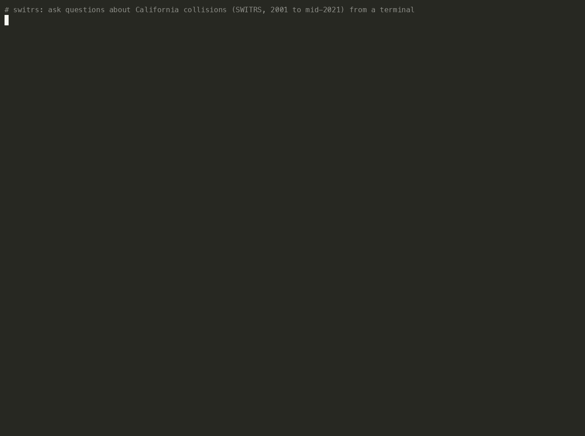
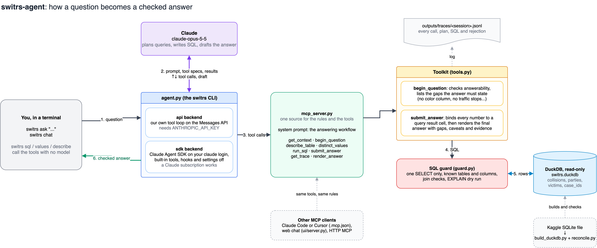

# switrs-agent

A question-answering agent for California traffic collisions (SWITRS, 2001-01-01 to 2021-06-03, about 9.4 million crashes). You ask in plain English from your terminal. The agent writes SQL, runs it against a read-only DuckDB copy of the data, and answers. Every number in the answer has to bind to a cell in a query result, or the server refuses the answer. When a question needs data the file does not have, such as vehicle color, the answer says so.



Video version: [docs/demo.mp4](docs/demo.mp4) (2 minutes). Every command in it ran for real on 2026-10-19 with the `sdk` backend; only the typing is simulated. `docs/demo.sh` re-records it.



The diagram source is [docs/architecture.drawio](docs/architecture.drawio). The PNG and SVG embed the draw.io XML, so either opens for editing at app.diagrams.net.

## Quick start

You need Python 3.12, [uv](https://docs.astral.sh/uv/), and the SWITRS SQLite file from Kaggle ([alexgude/california-traffic-collision-data-from-switrs](https://www.kaggle.com/datasets/alexgude/california-traffic-collision-data-from-switrs)). The data is not in this repo.

```sh
git clone https://github.com/youngfreezy/switrs-agent && cd switrs-agent
uv sync
uv run python scripts/build_duckdb.py --sqlite ~/Downloads/switrs.sqlite   # about 4 minutes, writes data/switrs.duckdb (1.3 GB)
```

Then pick how the agent calls Claude:

| Backend | Needs | What runs |
|---|---|---|
| `api` | `ANTHROPIC_API_KEY` | Our own tool loop in `switrs_agent/agent.py` on the Claude Messages API |
| `sdk` | a logged-in `claude` CLI (a Claude subscription works) | The Claude Agent SDK with every built-in tool off. The only tools are this project's |

The default is `auto`, which uses `api` when `ANTHROPIC_API_KEY` is set and `sdk` otherwise. Override with `--backend` or `SWITRS_BACKEND`. The model is `claude-opus-5-5` unless you pass `--model` or set `SWITRS_MODEL`.

## Ask the agent

```sh
uv run switrs ask "Which county has the most collisions?"
uv run switrs ask "What percentage of collisions involved a parked vehicle?"
uv run switrs ask "How has COVID-19 changed collisions, if at all?"
uv run switrs ask "Is there data showing police are biased against red sports cars?" -v
```

Each tool call prints as it happens, then the checked answer. `-v` also prints every query plan, the SQL and the first rows of each result. The footer shows the backend, model turns, time, estimated cost and the trace file.

### The five example questions

These are the questions the project was built against. Each answer below passed `submit_answer` in an agent run on 2026-10-19. Each is also a golden eval item whose expected values are recomputed from SQL and frozen in `evals/expected_v1.json`.

| Question | What a correct answer says |
|---|---|
| Which county has the most collisions? | Los Angeles: 2,851,925 collisions, 30.26% of all. Raw counts, not per capita, because the data has no population figures |
| What percentage of collisions involved a parked vehicle? | It depends on the definition. 7.38% of collisions are coded as primarily involving a parked motor vehicle. 9.99% have a party recorded as a parked vehicle (9.67% if you use "movement before the crash: parked") |
| Please prove or disprove that safety equipment actually works. | Crash records can describe this but cannot prove it. Among passenger-car occupants recorded as victims, 0.342% died when a lap/shoulder belt was recorded as used and 8.21% when recorded as not used. Belt status uses both equipment fields, and conflicting entries are excluded |
| How has COVID-19 changed collisions, if at all? | Collisions fell 22.1% from 2019 to 2020 (25.2% for April to December). April 2020 was 46.1% below April 2019. Fatal crashes stayed about flat, so the fatal share rose to 0.93% |
| Is there a police bias against red or flashier sports vehicles? | The data cannot test this. It has no vehicle color, no model or body style, and no traffic stops or exposure data. Any comparison by make is descriptive only |

For follow-up questions in one conversation:

```sh
uv run switrs chat
```

```
you> Which county has the most collisions?
you> And which of those five had the most fatal collisions?
```

## Use the tools without a model

The same tools the agent calls are available directly. The SQL guard applies here too.

```sh
uv run switrs context                                   # the grounding text the agent reads first
uv run switrs describe parties                          # columns, meanings, null share, real values
uv run switrs values parties vehicle_make --contains porsch
uv run switrs sql "SELECT county_location, COUNT(*) AS n FROM collisions GROUP BY 1 ORDER BY 2 DESC LIMIT 5"
uv run switrs sql "DROP TABLE collisions"               # rejected: only one SELECT is allowed
uv run switrs trace <session>                           # HTML review page for a session's trace
```

## How an answer is checked

The tools live in `switrs_agent/tools.py`. `switrs_agent/mcp_server.py` exposes them, with the agent's instructions, as an MCP server. The CLI loads both from that server, so the CLI, Claude Code and any other MCP client see the same tools and the same rules.

| Tool | What it does |
|---|---|
| `get_context()` | Tables, joins, columns with meanings and real values, metric definitions, caveats, and concepts the data does not contain |
| `begin_question(question, answerability, interpretation)` | Opens a turn. The server checks the question for concepts the data lacks and for causal wording, and returns the gaps the answer must state |
| `describe_table(table)`, `distinct_values(table, column, contains, limit)` | Look up columns and how categories are spelled |
| `run_sql(sql, purpose, query_plan)` | One guarded, read-only SELECT. Returns a query id, up to 200 rows, warnings and caveats |
| `submit_answer(turn_id, answer, claims)` | The only certification. Every number in the answer must be a claim bound to query result cells, with its entity and direction. On success the server renders the final answer with gaps, caveats and an evidence table, and the CLI prints exactly that |
| `get_trace()` | Every tool call in the session, including rejected queries and retries |
| `render_answer(turn_id)` | An HTML page for a certified answer: query plans, SQL, results and the trace |

A run usually goes: `get_context`, `begin_question`, one or more `run_sql`, then `submit_answer` until it is accepted. If no submission passes, the CLI prints the model's last text under a red "unverified" banner.

Every session appends each tool call (arguments, query plans, SQL, results, rejected attempts) to `outputs/traces/<session>.jsonl`.

### Guardrails against made-up answers

Each layer runs on the server, so it applies to every client, not only this CLI.

Before any SQL runs, `begin_question` classifies the question text. It looks for:

- concepts the data lacks: vehicle color, model or body style, traffic stops, other states, dates after 2021-06-03
- causal wording ("prove", "works", "bias")
- exposure wording ("safest", "per capita")

A declared status that contradicts the question, such as "answerable" for the red-car question, is refused. The gaps and caveats it finds are attached to the turn.

On every query:

- `run_sql` needs an open turn.
- The guard allows one read-only SELECT, with no file-reading functions.
- Unknown tables and columns are rejected, with a pointer to the real names.
- Joins between tables must be key equalities joined by AND. `ON TRUE`, `OR`, non-equality, and a victims join without `party_number` are rejected.
- Summing a crash-level column after joining to people in the same query is rejected; `WHERE EXISTS` is allowed.
- Each output column is traced through CTEs and subqueries. A column that is only a literal, such as `SELECT 100000 AS x`, can run but can never be cited as evidence.

On every answer, `submit_answer` checks each claim:

- It recomputes the value from the cited cells and the stated operation (value, ratio, percent, percent change, difference, sum).
- It checks the number in the text at its displayed precision.
- A decrease must read as a decrease.
- The named entity must match the cited row's label.
- Cells must come from queries run for this question.
- Every number in the prose must belong to a claim.

The server, not the model, then writes the gaps, caveats and an evidence table into the final answer. The model can't leave them out.

The CLI and the web chat show only an answer that passed `submit_answer`. Anything else appears as unverified working notes.

Execution limits:

- read-only connection, external file access off, configuration locked
- 4 GB memory and 4 GB temp disk per process
- one 60-second deadline covering EXPLAIN, execution and fetch
- 200 rows and 150 KB per result
- 25 queries per question, 200 per session

### Data: SQLite source and DuckDB copy

The Kaggle SQLite file is the untouched source. It is only ever opened in immutable read-only mode. `scripts/build_duckdb.py` makes an analytical copy, and `scripts/reconcile.py` must pass before the tools will start. Reconciliation checks:

- non-NULL counts per column against the source (any value lost in conversion fails)
- key uniqueness and orphan rows
- aggregates by year, severity, county and injury

The result goes in `data/dataset_meta.json`, along with the source SHA-256 and the DuckDB file's size and modification time. The tools refuse to start if the database changed after reconciliation.

DuckDB was kept for speed, not accuracy. On the same queries the two engines returned identical results (9 of 9 here, and 10 of 10 over three repeats in a separate review). SQLite took 86 to 111 seconds in total, against 1.35 to 1.5 seconds for DuckDB. An indexed SQLite copy was not tested because the build machine lacked the disk space.

## Other ways to run it

Claude Code, Claude Desktop, Cursor or Codex: open the folder. `.mcp.json` registers the `switrs` server.

Local web chat at http://127.0.0.1:8800. It streams each tool call as a card (query plan, SQL, rows) and keeps chats. Follow-ups resume the same Claude session, and messages to one chat run one at a time.

```sh
uv run uvicorn ui.server:app --host 127.0.0.1 --port 8800
```

The web chat and `evals/run_evals.py --agent claude` run headless Claude Code, billed to whatever the `claude` CLI is logged in to. To pin a Claude subscription for this project only, put a token from `claude setup-token` in `.env` as `CLAUDE_CODE_OAUTH_TOKEN=...`. Both refuse to run on API-key billing unless `.env` sets `SWITRS_ALLOW_API_BILLING=1`.

Hosted MCP over HTTP:

```sh
uv run python -m switrs_agent.mcp_server --http --port 8765    # streamable HTTP at /mcp
docker build -t switrs-agent . && docker run -p 8765:8765 -v $PWD/data:/app/data:ro switrs-agent
```

The HTTP mode has no authentication. Add auth before exposing it beyond localhost.

## Tests and evals

```sh
uv run pytest -q                                            # guard, claim-checking, adversarial and evaluator tests
uv run python evals/run_evals.py --expected                 # recompute golden values from SQL, no model calls
uv run python evals/run_evals.py --freeze                   # approve changed golden values as the new baseline
uv run python evals/run_evals.py --agent claude --budget 2  # run the golden questions through the agent
uv run python scripts/reconcile.py --sqlite PATH            # SQLite vs DuckDB reconciliation
uv run python scripts/compare_engines.py --sqlite PATH      # same queries on both engines, results then timing
```

`evals/golden.yaml` holds 11 questions: the five examples, the precise belt question behind example 3, and five traps. The traps are a fan-out count, a 2019 motorcycle count, the hour with most fatal crashes, sparse cellphone data, and a Las Vegas question the data cannot answer.

Number checks are sign-aware and require the entity in the same sentence. A question passes only if its answer passed `submit_answer`, and the grader reads that certified answer from the trace. If the golden SQL's values drift from `expected_v1.json`, the run stops until someone reviews the change and approves it with `--freeze`. Tests deliberately corrupt correct answers (swapped entity, flipped sign, inflated number, invented Las Vegas count) and require the grader to reject them.

Latest agent run, 2026-10-19, `claude-opus-5-5` through headless Claude Code with only this project's tools:

- 11 of 11 passed, and every answer passed `submit_answer`. The run itself graded 9 of 11. Both misses were grader errors, found by reading the answers and then fixed. q02 had used a legitimate third definition of "parked", and q08 wrote "Six pm".
- 0 to 5 rejected submissions per question before one passed. Every rejection was an unbound number, a mismatched entity or a wrong direction.
- $3.84 for all 11, about $0.19 to $0.59 per question.

These 11 questions are a smoke test. The grader was adjusted while reading these answers, so passing them is not evidence of general reliability.

## Known limits

- A passing `submit_answer` proves each number came from a cited result cell. It does not prove the query measured what the question asked. Read the query plans (`switrs ask -v`) for anything that matters.
- Each claim contains one numeric assertion. Labelled clauses start with the exact entity and a simple predicate ("Los Angeles had 2,851,925 crashes"). Use separate claims for separate clauses; numbers repeated from the question still require evidence. Calendar years in context such as "in 2020" remain labels.
- SQL provenance follows CTEs, subqueries, and wildcard outputs. A set-operation column is citable only if every branch is data-derived. Mixed literal/data columns cannot be cited, even for their data-derived rows.
- Joins through simple projections and filters preserve known keys, including renamed key columns. Joins through aggregates or other complex derived relations are rejected when their keys cannot be established. Use base-table joins or `WHERE EXISTS` for person filters. Use `EXISTS`/`NOT EXISTS` instead of explicit `SEMI`/`ANTI JOIN`. Fan-out state is retained through window functions and grouped derived results; the guard can conservatively reject an aggregate whose deduplication it cannot prove.
- The model can still add hedged speculation about causes in prose, as in the fatal-share answer in the demo.
- Statements without numbers, such as "LA is the most populous county", can't be checked mechanically. The instructions forbid facts that don't come from query results.
- Arithmetic that zeroes out a data column (`n * 0 + 100000`) still counts as data-derived.
- Queries run in the server process, not an isolated worker. The DuckDB limits cap memory, temp disk and time, but untrusted multi-user hosting needs process isolation.
- An MCP client other than this CLI and the web chat can skip `submit_answer` or rewrite its output. The server guarantees only what it renders.
- The sentence-start rule for labelled claims is strict. It makes prose stiff and can take several submissions (six on the fatal-hour question).
- The data ends 2021-06-03, and the last months before that are only partly loaded.
- The `api` backend has not yet run against the live API (the build machine had no API key). The demo ran on the `sdk` backend.
- The HTTP MCP server has no authentication and shares one toolkit across clients. It isn't ready for public hosting.
